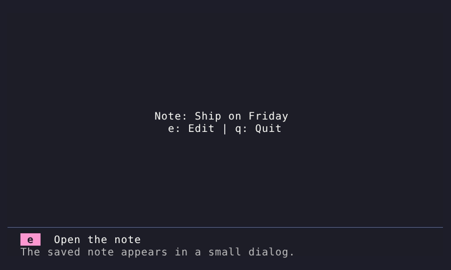

# reflex-vty examples

Tech demos built on the reflex-vty core. Some of these are ports of (and riffs on)
the [Bubble Tea examples](https://github.com/charmbracelet/bubbletea/tree/main/examples).
Each is a module under [`src-bin/Example/`](src-bin/Example/) and can be run with:

```bash
cabal run examples -- <name>
```

## Canvas animations

### `doom-fire`: the classic Doom fire

A heat grid seeded from a "hot" bottom row. Every frame each cell cools a little
and drifts upward from the cell below it, and the heat is mapped through a
black-red-orange-yellow-white gradient. ([source](src-bin/Example/DoomFire.hs))


### `cellbuffer`: a plasma field

Each cell's character (ordered by density: `" .:-=+*#%@"`) and its color are
a function of position and time, summed over a handful of sine waves.
([source](src-bin/Example/CellBuffer.hs))


### `space`: a drifting starfield

Stars with pseudorandom rows and depths warp leftward. Faster (nearer) stars are
brighter and drawn with a bolder char. ([source](src-bin/Example/Space.hs))


### `splash`: an animated splash screen

Introducing... ([source](src-bin/Example/Splash.hs))


### `canvas`: a glyph-level drawing board

An interactive tour of `Reflex.Vty.Canvas`. A checkerboard of dots shows
transparency (the gaps are transparent, not dark). The glyph row holds the
two-column glyph `漢`, the marked glyph `á` (a base `a` plus a combining acute
in its own color), and a `…` ellipsis where a wide glyph crosses the board's
right edge — Vty's partial-glyph clipping policy. Arrow keys move a `█`
highlight overlay; placing it over a glyph clips or covers it per the same
policy, and moving away restores it. ([source](src-bin/Example/CanvasDemo.hs))


## One note, one dialog

The companion package's small note editor runs with:

```bash
nix-shell --run 'cabal run widgets-demo'
```

[`Example.TierA`](reflex-vty-widgets/app/Example/TierA.hs) demonstrates one
composition: a text field inside a dialog, with explicit save and cancel.
The screen starts with `Note: Ship on Friday` and just two controls:
`e` opens the editor; `q` quits.

In the dialog, Enter saves the draft and Escape discards it. Reopening always
starts from the saved note, not a canceled draft. Printable keys—including
`e` and `q`—edit the draft instead of triggering background commands.
Ctrl+C quits from either screen. Notes live only for the current process;
this example does not write a file.



To regenerate the recording, prebuild the executable and run the tape:

```bash
nix-shell --run 'cabal build widgets-demo'
nix-shell -p vhs ttyd ffmpeg chromium python3 --run 'vhs doc/widgets-demo.tape'
```

The recording changes Friday to Monday and cancels, reopens the original
Friday text, then makes the same edit and saves. Short captions and visible
key badges explain those two outcomes; no unrelated widgets share the screen.

The tape uses [`widgets-demo-pty.py`](doc/widgets-demo-pty.py) only to select
captions with recording control bytes and paint a three-row band outside the
application viewport. All editing uses real keys and typed text. Caption
output never interrupts a partial terminal escape sequence or follows
application cleanup. The adapter propagates the child's exit status, which
the tape checks.

Production-widget tests cover draft reset, save/cancel, input isolation,
resizing, and shutdown. Direct-PTY checks run the executable without the
recording adapter to verify the workflow and terminal restoration.
